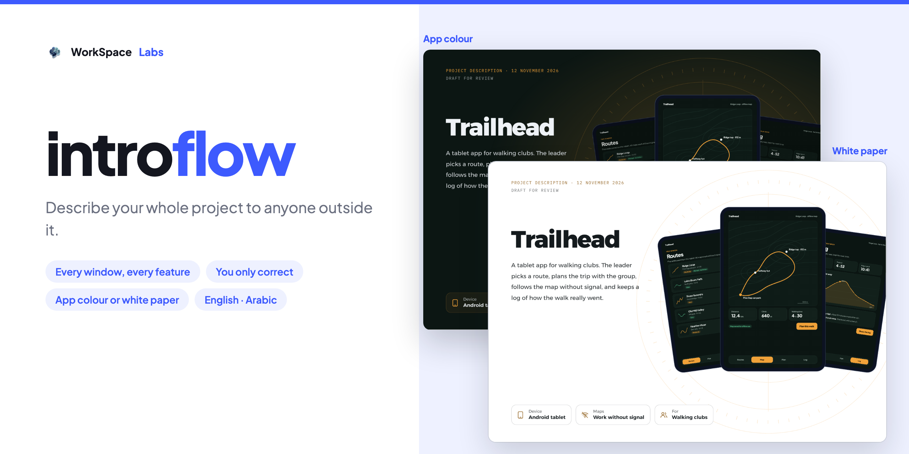

# introflow



**Describe your whole project to anyone outside it: every window, every feature.**

An agent skill that makes a **project description** for a client, a judge, a manager, new staff, or a friend
who asks "what is this project?". The agent reads the project, lists every window and feature it finds, and
drafts every word; you only confirm or correct. Then it draws a PDF with the app's real screens, in **the
app's own colours**, on **white paper for printing**, or both.

**It is as long as the project.** A small app gives a short document; a large one gives a long one. The
project decides what there is to describe, and you decide what to make from it: the full description, a
simple four-page introduction, or a deeper book. The skill sets no number of pages.

The skill is the folder [`skills/introflow/`](skills/introflow/): its instructions,
[`SKILL.md`](skills/introflow/SKILL.md), and a page template that draws the description in any browser.
**Nothing to install.**

**Version 0.2.0** · 57 automated tests (24 of them open the real page in a browser) · [how it was tested](TESTING.md)

---

## What you get

In your project's `docs/intro/`:

| File | What it is |
|---|---|
| `intro.md` | the description as short, readable text: the master copy any agent can read and update |
| `intro.html` | the page that draws it (open it in Chrome, Edge or Safari) |
| `<Project> - Project intro.pdf` | the PDF in the app's own colours, to send or show on a screen |
| `<Project> - Project intro (print).pdf` | the same pages on white paper, for a client who prints |
| `screenshots/` | the app's real screens, with demo data |

A **full description**, A4 lying on its side:

1. **The cover**: the name, what it is in two or three sentences, the app's screens, three facts.
2. **Contents**: every part and every window, with its page.
3. **An introduction**: a few paragraphs that set the reader up.
   Then **who it is for, and why.**
4. **Every window**, grouped in parts like chapters. Each part opens with all its windows, small. Each window
   then has its own page: the screen large, what it is for, what you see and do there, a closer look, and the
   features that live in it. A window with a lot to say runs on to further pages.
5. **The features** of the whole app.
6. **What makes it different**, and a **conclusion**.

A **simple introduction** is four pages: the cover, who it is for, up to four windows on one page, and what
makes it different.

Four frames: **phone**, **tablet**, **desktop window** and **browser**, with screens upright or wide.
English by default; **Arabic** turns every page right to left.

## How it works

1. The agent asks four things: **how much** (full, simple or a book), **who will read it**, **which
   language**, and **which paper** (app colour, white, or both).
2. It **reads the whole project** and changes nothing in it. For a full description it **lists every window
   and feature it found**, grouped in parts, and waits for your yes that nothing is missing.
3. It **drafts every word** and shows them to you as plain text. What it worked out itself (usually *why it
   was built* and *what makes it different*) is marked as a guess. A fact the files do not hold is asked,
   never invented.
4. You say **yes** or **change this**. Only then it draws: **the page lays itself out**, however many pages
   that takes, and refuses with numbered problems if a line is wrong or does not fit.
5. It makes the PDF or PDFs with the Chrome or Edge you already have, or tells you the exact Print settings.
6. A guess stays tagged "To confirm" until you confirm it, and the description cannot be marked
   **approved** while one remains.

## Install

By hand, for Claude Code (macOS or Linux, Bash). The copy refuses an existing folder; back up an existing
installation before choosing to replace it:

```bash
skill_root="$HOME/.claude/skills"
skill_target="$skill_root/introflow"
if [ -e "$skill_target" ] || [ -L "$skill_target" ]; then
  printf '%s\n' "Already exists: $skill_target. Back it up before updating." >&2
  false
else
  mkdir -p "$skill_root" && cp -R introflow/skills/introflow "$skill_target"
fi
```

**Claude app (chat and Cowork)**: make the zip, then upload it in **Customize → Skills**.

```bash
cd introflow
mkdir -p dist && (cd skills && zip -r -X -FS ../dist/introflow.zip introflow -x '*.DS_Store')
```

**Codex, GitHub Copilot, Cursor and ChatGPT**: where your tool supports agent skills, install the same
folder. Not tested yet.

## Try it without an agent

Open [`skills/introflow/assets/template/intro.html`](skills/introflow/assets/template/intro.html) in a
browser. To see an example, paste the text of one of the files in
[`skills/introflow/examples/`](skills/introflow/examples/) between the two `intro` lines in that file, and
reload. Screens without a picture show a "Screenshot missing" box.

## The text copy

```markdown
# Trailhead

- kind: tablet
- about: A tablet app for walking clubs. The leader picks a route, plans the trip and follows the map without signal.
- stage: #0c1613
- accent: #f2a33a

## facts
- Device [tablet]: Android tablet

## who
- For whom: The walk leader of a small club.
? Why it was built: Because paper maps and group chats do not show who is coming and when to turn back.

## what
### Before the walk: Choosing where to go, and getting everyone ready
1. Routes: Every saved walk with its distance, time and difficulty.
   shot: screenshots/1-routes.png
2. Trip plan: Who is coming, the kit list and the turn-back time.
   shot: screenshots/2-plan.png
   more: The plan is one page the whole group can check before leaving the car park.
   sees: Who is coming, and who leads
   does: Ticks each item as it is packed
   feature: Turn-back time: The hour the group turns back if the top is not reached.

## features
- Works without signal: Maps and plans are saved on the tablet before the walk.

## different
- One tablet for the group: Nothing to install on anyone's phone.
```

Add as many windows, parts and features as the project has. A line starting with `?` is the agent's guess,
still to confirm. `- depth: simple` asks for the four-page introduction instead. The full shape is in
[`references/intro-format.md`](skills/introflow/references/intro-format.md).

## Its family

introflow is the third of three skills that describe a project before and after it is built:
[workflow-project](https://github.com/workspace-labs/workflow-project) draws how the whole project works,
[frameflow](https://github.com/workspace-labs/frameflow) draws its screens, and introflow describes what it is, window by window.

## Licence

MIT (see [`LICENSE`](LICENSE)). The fonts are under the SIL Open Font License (see [`CREDITS.md`](CREDITS.md)).
